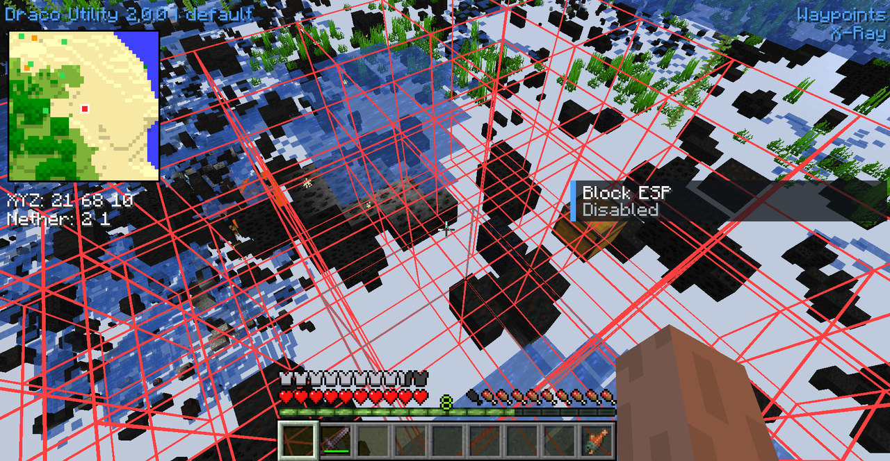
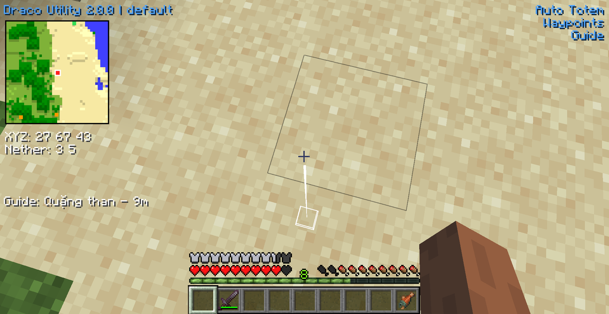
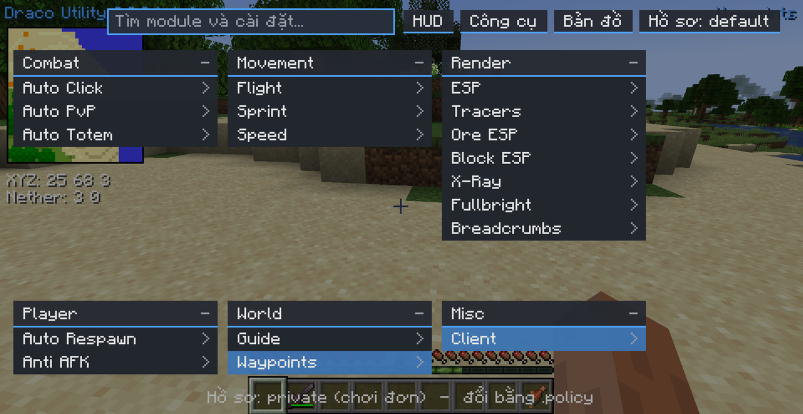

# Draco Utility 2.0.0

**A product of Draco Studio.**
Copyright (C) 2026 DUCNGUYEN-creator (Draco Studio). Licensed under the **GNU General Public License v3**.

A client framework for Minecraft Java Edition (Fabric 1.21.1) for **singleplayer** and **your own private server**:
a module system with a Click GUI, a HUD editor, ESP, X-ray, a guide line, a minimap with waypoints, setting profiles,
a per-server policy that decides which modules may run, and chat commands. Version 2.0.0 is a rewrite of 1.1.0 around a
small core engine, so every feature is a module that uses the same settings, events, config, render and scheduling
systems.

| | |
|---|---|
| Mod name | Draco Utility (`dracoutility`) |
| Version | 2.0.0 |
| Developer | DUCNGUYEN-creator (Draco Studio) |
| Minecraft | 1.21.1 |
| Loader | Fabric Loader 0.16.0 or newer, plus Fabric API for 1.21.1 |
| Java | JDK 21 |
| Environment | Client only (nothing to install on the server) |
| License | GNU GPL v3 (see `LICENSE`) |

---

## 1. Read this first

### Two kinds of "profile"

The word is used for two separate things, and the Click GUI shows both:

| Name | What it stores | Where you see it | Commands |
|---|---|---|---|
| **Setting profile** | module states, settings, HUD and GUI layout | "Profile: default" button in the top bar, watermark | `.profile ...` |
| **Policy profile** | which *capabilities* are allowed where you play | status line at the bottom of the Click GUI | `.policy ...` |

### Server policy

Every module declares what it does to the game (its *capabilities*). A policy profile lists which capabilities are
allowed, and a module only runs while the active policy profile allows all of its capabilities.

| Capability | Typical modules |
|---|---|
| `local_ui` | menus, themes, HUD |
| `local_visual` | Fullbright, Breadcrumbs |
| `navigation` | Waypoints, Guide |
| `world_information` | ESP, Tracers, Ore ESP, Block ESP, X-Ray, Guide (ore / mob targets), minimap, Target HUD, Info |
| `movement` | Flight, Speed, Sprint |
| `combat` | Auto PvP |
| `automation` | Auto Click, Auto Totem, Auto Respawn, Anti AFK |
| `network` | reserved for protocol-level features; no module uses it yet |

| Policy profile | Allows | Used for |
|---|---|---|
| `private` | everything | **singleplayer** (automatic) |
| `info` | `local_ui`, `local_visual`, `navigation`, `world_information` | servers you bind to it |
| `visual` | `local_ui`, `local_visual`, `navigation` | **every other server** (default) |

- On a server you run, join it and type `.policy trust` once. That server then uses `private`.
- `.policy` shows the active profile, `.policy list` shows all profiles and bindings, `.policy bind <profile> [server]`,
  `.policy unbind`, `.policy create <name> [copy]`, `.policy set <profile> <capability> <on|off>`,
  `.policy default <profile>`, `.policy singleplayer <profile>`. Built-in profiles cannot be edited; make a copy
  with `.policy create`.
- A module the policy does not allow cannot be switched on; if it was already on it stops and shows as `SUSPENDED`
  (red name in the Click GUI, the tooltip tells you why). It resumes when the policy allows it again.
- Policy settings are global (not part of a setting profile) and are saved in `config\draco\policy.json`.

**What this does and does not do.** Draco does not detect, hide from or evade any anti-cheat, and nothing here promises
that a module passes a given server's checks. The policy only keeps you from running modules you did not allow
for that place, so behaviour is predictable and easy to reproduce. If you run an anti-cheat on your own test server
to see how modules behave, treat what it reports as test data.

**Intended use.** Singleplayer, or a private server whose rules allow it. Teleport, commands, creative mode and stat
boosts are real server commands (`/tp`, `/gamemode`...) that need permission level 2+; the server still checks them.

### Verification

Automated: **215 checks pass** on the core (`gradlew selfTest`; the same suite had 151 checks before the policy,
parser and hardening work). The Minecraft side compiles against the real Minecraft 1.21.1 and Fabric API jars.

In-game check on **17 Nov 2026**: Minecraft 1.21.1 with Fabric, **singleplayer**, policy profile `private`.

| Feature | Result | Observed |
|---|---|---|
| ESP box (mob) | Pass | All 12 edges visible and even; the box wraps the whole sheep. Target HUD showed 8.0 / 8.0 at 2.3 m |
| Ore ESP | Pass | 12 edges on every box, visible through the sand, boxes stay complete where they touch |
| X-Ray | Pass, but busy | Hides soil, stone and sand; red borders on hidden blocks around you. With the default border radius (3) standing close fills much of the screen; lower **Border radius** or turn **Borders** off for a cleaner view |
| Guide | Pass | Line and box to the nearest coal ore, "Guide: Quặng than - 9m" in the HUD |
| Click GUI | Pass | Six category columns, search bar, HUD / Tools / Map / Profile buttons, Tracers and Speed listed, policy status line |
| Minimap and map screen | Pass | Terrain colors, ore dots, waypoint dialog, zoom |
| HUD | Pass | Watermark, coordinates, active modules, target HUD |
| Tracers | Bug found, fixed, **not re-tested** | The first build drew a huge wedge from the crosshair (one world width for the whole line). Width is now computed per end |

Not tested yet: `.policy trust` on a real server, Flight / Speed / Auto PvP, Tab completion for `.` commands, the
unclosed-quote error message, addons, Sodium and Iris (`.compat` lists what is loaded). Known cosmetic issue: the
policy status line at the bottom of the Click GUI can overlap the settings panel.

---

## 2. Install (Windows)

1. Install **JDK 21** (Temurin is recommended) and **Fabric Loader for 1.21.1** (TLauncher has a ready-made
   "Fabric 1.21.1" version).
2. Download **Fabric API** for 1.21.1 from Modrinth (choose Minecraft 1.21.1 and Fabric) and put the `.jar` in your
   `mods` folder.
3. Close Minecraft.
4. Extract this project, open the extracted folder and double-click **`install.bat`**. It builds the mod, deletes older
   `dracoutility-*.jar` files in `D:\.minecraft\mods` and copies the new jar there. If your game folder is different,
   open `install.bat` in Notepad and change the path.
5. Start the game with **Fabric 1.21.1**.

```
mods/
  dracoutility-2.0.0.jar
  fabric-api-<version>+1.21.1.jar
```

Only `.jar` files belong in `mods`; never keep two versions of `dracoutility` there at the same time.

### Updating from 1.x

On the first start the mod finds `config/dracoutility.properties`, `dracoutility_waypoints.txt` and
`dracoutility_history.txt` from 1.x and converts them into the new format (module states and settings, waypoints and
command history). The old files are left untouched.

---

## 3. Build manually

The project ships with the Gradle wrapper (Gradle 8.10, Fabric Loom 1.7).

```
cd <project folder>
.\gradlew.bat build        (Windows PowerShell)
./gradlew build            (macOS / Linux)
```

The first build takes a few minutes (Minecraft, mappings and libraries are downloaded). `BUILD SUCCESSFUL` means it
worked.

**Where the .jar is after building:**

```
<project folder>\build\libs\dracoutility-2.0.0.jar
```

Use **`dracoutility-2.0.0.jar`** (the mod). Do **not** use `dracoutility-2.0.0-sources.jar`.

Versions live in `gradle.properties` (Minecraft 1.21.1, Yarn `1.21.1+build.3`, Loader 0.16.5, Fabric API
`0.102.0+1.21.1`). If Gradle cannot find one, take the current numbers for 1.21.1 from `fabricmc.net/develop`.

**Low disk space on C:?** Gradle caches libraries in `C:\Users\<name>\.gradle`. Set the `GRADLE_USER_HOME`
environment variable (for example `setx GRADLE_USER_HOME "D:\Downloads\gradle-home"`) and open a new PowerShell.

---

## 4. Using it

### Keys

| Default key | Action | Rebind in |
|---|---|---|
| **Right Shift** | Open / close the Click GUI | Options > Controls > Draco Utility |
| **M** | Open the large map | same |
| (unbound) | Open the tools screen, open the HUD editor | same |

Module keybinds are set in the Click GUI (open a module, click **Bind**) or with `.bind <module> <key>`. A bind can
toggle the module or hold it. Binds are ignored while a screen is open.

### Click GUI

One panel per category (Combat, Movement, Render, Player, World, Misc), plus **Favorites** and a search **Results** panel.

| Action | Result |
|---|---|
| Left click a module | Toggle it |
| Right click a module | Open / close its settings |
| Middle click a module | Add / remove from Favorites |
| Drag a panel header | Move the panel (position is saved) |
| Right click a panel header | Collapse the panel |
| Mouse wheel over a panel | Scroll it |
| Type anywhere | Search modules, descriptions and setting names |
| Settings: click / drag | Toggle, slider (drag), cycle a choice (right click goes back), type text, pick a color, press a key |
| Right click a number | Reset it to the default |

Top bar buttons: **HUD** (HUD editor), **Tools** (teleport, stats, commands), **Map**, and **Profile** (the *setting*
profile: left click = next, right click = previous). The bottom line shows the active *policy* profile and where you are
(see section 1). A module that the policy blocks has a red name; hover it for the reason.

The GUI text follows the game language (English or Vietnamese); module names and descriptions are English.

### HUD editor

Drag elements to move them (hold **Shift** for a coarse 8 px grid), scroll to scale, right click to show or hide,
middle click to reset one element. Elements are anchored to the nearest screen corner, so the layout survives a
change of window size.

### Chat commands

Prefix `.` (changeable in the **Client** settings). Messages starting with the prefix are handled by the mod and
never sent to the server.

| Command | What it does |
|---|---|
| `.help [command]` | List commands or explain one |
| `.toggle <module>` / `.enable` / `.disable` | Turn modules on and off |
| `.modules [category]` | List modules |
| `.set <module> [setting] [value]` | Show or change settings (`.set esp range 64`) |
| `.bind <module> <key\|none>` | Key bindings (letters, digits, f1-f12, space, rshift, mouse4...) |
| `.profile list\|load\|create\|copy\|delete\|rename\|export\|import` | Setting profiles |
| `.waypoint add <name>\|list\|remove <name>\|guide <name>` | Waypoints (alias `.wp`) |
| `.policy [trust\|list\|bind\|unbind\|create\|delete\|set\|default\|singleplayer]` | Which capabilities are allowed where you play (section 1) |
| `.compat` | Minecraft version, related mods (Fabric API, Sodium, Iris, Indium, Mod Menu, ViaFabricPlus) and addons that are loaded |
| `.config save\|reload` | Save or reload all settings |
| `.gui` `.hud` `.map` `.tools` | Open screens |
| `.perf` | Timing information |

Press **Tab** (or just keep typing) in the chat box after the prefix to complete command names, modules, settings and
profile names. Quote text that contains spaces (`.waypoint add "my base"`); an unclosed quote is reported as an error
instead of being swallowed. Use `\"` for a literal quote.

---

## 5. Modules

| Module | Category | Capability | What it does |
|---|---|---|---|
| **Auto Click** | Combat | automation | Attacks what you look at, mines, or places blocks; clicks per second 0.5 - 20 |
| **Auto PvP** | Combat | combat | Attacks the best target in reach (alias `killaura`). Reach is measured from your eyes to the hitbox (default 3.0). Settings: players / hostile / passive, range, rotate, priority (nearest or lowest health), attack charge, line of sight, field of view, pause while using an item, ignore your own pets |
| **Auto Totem** | Combat | automation | Keeps a Totem of Undying in your off hand |
| **Flight** | Movement | movement | Survival flight by velocity (a dedicated server needs `allow-flight=true`); conflicts with Speed |
| **Sprint** | Movement | movement | Sprints automatically when you walk forward |
| **Speed** | Movement | movement | Faster walking in the direction you move (default 0.4 blocks per tick, only on the ground); conflicts with Flight |
| **ESP** | Render | world_information | Colored boxes and name + distance labels through walls: players red, hostile orange, passive green, items yellow (colors are settings); optional fill |
| **Tracers** | Render | world_information | Lines from your crosshair to players, mobs and items, colored by kind |
| **Ore ESP** | Render | world_information | White boxes and labels for ores; filter by ore type, scan radius 8 - 64 |
| **Block ESP** | Render | world_information | Highlights any blocks you name (default chests, barrels, shulker boxes) |
| **X-Ray** | Render | world_information | Only ores, minerals, building blocks, wood, leaves and functional blocks stay visible; red borders (radius 1 - 8, default 3, at most 2500 boxes) on hidden blocks that would block movement; optional fullbright |
| **Fullbright** | Render | local_visual | Client-side night vision |
| **Breadcrumbs** | Render | local_visual | Trail of where you walked |
| **Guide** | World | navigation, world_information | A line to the nearest ore (with type filter), player, hostile or passive mob, item, or to a named waypoint, in the target's color |
| **Waypoints** | World | navigation | Shows saved waypoints in the world with name and distance |
| **Auto Respawn** | Player | automation | Respawns when you die |
| **Anti AFK** | Player | automation | Small actions now and then |
| **Client** | Misc | none (always on) | Theme (Classic / Minimal / Glass), accent color, animations, language, command prefix, notification and performance options |

All settings are shown in the Click GUI automatically; they also work with `.set`.

### X-ray details

A whitelist: **ores** (every `_ore` block and Ancient Debris), **mineral blocks**, **wood and leaves**, **building
blocks** (bricks, concrete, glass, wool, stairs, slabs, walls, fences, doors, polished / chiseled / smooth stone,
cobblestone...) and **functional blocks** (everything with block-entity data such as chests, furnaces, spawners,
signs, beds, plus crafting tables, anvils, rails, pistons, TNT, obsidian, ladders, levers...). Everything else is
see-through. Water and lava are still drawn.

---

## 6. HUD elements

All are positioned in the HUD editor and saved with the profile.

| Element | Content |
|---|---|
| Watermark | Name, version, active profile |
| Minimap* | Corner map, size 48 - 160, zoom 1 - 8 blocks per cell; shows ores, entities, waypoints |
| Coordinates | XYZ and the matching Nether / Overworld coordinates |
| Info* | Nearest player and the guide target |
| Direction, Speed, FPS, Ping | Small text readouts (hidden by default except Coordinates) |
| Armor | Four armor pieces with durability |
| Active Modules | Running modules, right aligned |
| Target HUD* | Name, health bar and distance of what you look at |
| Notifications | Toast messages (module on / off, errors, profile changes) |
| Performance | Tick, render, scheduler times, listener count, slowest modules |

\* needs the `world_information` capability; hidden when the active policy profile does not allow it.

---

## 7. Profiles and files

Setting profiles hold the module states and settings, the HUD layout and the GUI layout. Waypoints, command history
and the server policy are shared by all setting profiles.

```
<game folder>\config\draco\
  config.json                 active profile, schema version
  waypoints.json              (shared)
  history.json                (shared)
  policy.json                 (shared) policy profiles and server bindings
  profiles\<name>\modules.json
  profiles\<name>\hud.json
  profiles\<name>\gui.json
  backups\                    automatic backups (newest five kept per file)
  exports\                    exported profiles
```

How the files are handled:

- **Versioned**: every file carries a schema number; older files are migrated step by step.
- **Atomic writes**: written to a temporary file, then moved into place; the previous file is backed up first.
- **Self-healing**: a corrupt file is restored from the newest good backup, or set aside as `*.corrupt-<time>` and
  replaced by defaults. You get a chat message about it when you join a world.
- **Debounced**: dragging a slider does not write a file per step; the config is saved after two quiet seconds, when
  a screen closes and when the game exits.

---

## 8. Architecture

```
DracoUtilityClient -> Bootstrap (ordered lifecycle phases)
                         |
   +---------------------+---------------------------------------------+
   | Core (no Minecraft code, covered by the self-test)                |
   |  EventBus  Setting engine  Module + ModuleManager  ConfigManager  |
   |  ProfileManager  PolicyManager  WorkScheduler  Lifecycle          |
   |  CommandManager  ServiceRegistry  NotificationManager  Profiler   |
   |  Json  LongList                                                   |
   +---------------------+---------------------------------------------+
                         |
   Services: EntityService  PlayerService  BlockScanner  InfoService  NightVision
   Render API (RenderContext, RenderManager, BlockCache)   HUD framework (HudManager)
   Click GUI / HUD editor / Tools / Map     Addon API (AddonManager)     Modules (the features)
```

Key rules:

- **Modules never talk to each other.** They share data through services (one entity scan per tick no matter how many
  modules need it; block scans are spread over ticks by the scheduler).
- **A module registers event listeners in `onActivate()` with `on(...)`**; they are removed automatically when it is
  deactivated, so nothing outlives the module.
- **Module state machine**: `REGISTERED, DISABLED, ENABLING, ENABLED, DISABLING, SUSPENDED, FAILED`. A failed
  activation rolls back completely. Three errors within five seconds switch a module off without affecting others.
  `SUSPENDED` means "enabled by you but held back" (no world, or the policy does not allow it).
- **Resources are always given back**: when a module stops, even if its `onDeactivate()` throws, its event listeners and
  the shared services it acquired (entity scan, block scans, night vision) are released.
- **Policy first**: a module declares `capabilities(...)`; `ModuleManager` asks the `PolicyManager` before it runs it.
- **Rendering goes through one API**: modules describe boxes, lines, fills and labels; `RenderManager` culls them,
  batches them and restores the GPU state. Outlines are drawn as camera-facing ribbons (all 12 edges of a box, constant
  width on screen) rather than GL lines, with depth test, depth function, blend and cull set explicitly for each pass.
- **No garbage in hot paths**: `BlockScanner` keeps packed `long` positions, and `BlockCache` rebuilds an ESP's
  sorted box list only when the scan result changes, you move more than half a block, or half a second passes.
- **The GUI is generated from the Setting API**, so a new module needs no GUI code.

### Adding a module

```java
public final class MyModule extends Module {
    private final Setting.Int range = general.integer("range", "Range", "Blocks.", 10, 1, 50);

    public MyModule() {
        super("mymodule", "My Module", "Does something useful.", ModuleCategory.MISC);
        capabilities(Capability.LOCAL_VISUAL);       // what it does to the game; the policy decides if it may run
        requires(EntityService.class);               // optional: services it needs
    }

    @Override protected void onActivate() {
        on(TickEvent.Post.class, e -> { /* runs every tick while the module is active */ });
    }
}
```

Register it in `Bootstrap.registerModules` (or from an addon, below). It appears in the GUI, `.toggle`, `.set`, search, profiles and the
keybind system with no further work.

### Addons

An addon is a separate Fabric mod with a `draco-addon` entrypoint in its `fabric.mod.json`:

```json
"entrypoints": { "draco-addon": ["com.example.MyAddon"] }
```

```java
public final class MyAddon implements DracoAddon {
    @Override public String name() { return "My Addon"; }
    @Override public void onInitialize(AddonContext ctx) {
        ctx.registerModule(new MyModule());      // must declare at least one capability
    }
}
```

`AddonContext` offers `registerModule`, `registerCommand` and `registerHudElement` only. The addon API version is
`Draco.API_VERSION` (currently 1); an addon written for another version is skipped, and an addon that throws is
logged without affecting the client. Addon modules obey the same server policy as built-in ones. `.compat` lists loaded
addons and their problems. This API is new and has not been tried with a real addon yet.

### Source layout

```
src/main/java/studio/draco/utility/
  DracoUtilityClient, Draco          entrypoint, owner of all systems
  addon/                             public addon API (DracoAddon, AddonContext, AddonManager)
  bootstrap/                         Bootstrap (lifecycle steps, events, per-tick wiring)
  core/                              Minecraft-free engine (event, setting, module, config, scheduler,
                                     lifecycle, command, notification, policy, profiler, service, util)
  event/                             tick, render and world events
  services/                          entity / player / block scan / info services, targets, X-ray filter
  render/                            RenderContext, RenderManager, BlockCache
  modules/<category>/                the features
  hud/ and hud/elements/             HUD framework and elements
  gui/                               ClickGui, Theme, HudEditorScreen, ToolsScreen, MapScreen
  world/minimap, world/waypoint      map sampling, waypoint data
  input/, commands/, platform/       keybinds, chat commands, game-state helpers (Access)
  mixin/                             X-ray chunk culling (vanilla and Sodium), chat command completion
src/test/java/                       CoreSelfTest (plain Java, no JUnit needed)
```

### Running the self-test

```
.\gradlew.bat selfTest
```

It checks the event bus (priority, cancellation, duplicate protection, error isolation, thread guard), settings,
the module state machine (gate, rollback, conflicts, error auto-disable), JSON, config files (atomic write,
debounce, backup recovery, corruption, migration), profiles, the scheduler (budget and starvation), lifecycle,
notifications, the 1.x importer, the command framework, the server policy (profiles, bindings, persistence, module
gating), the strict JSON parser (depth limit, number grammar), the command tokenizer and resource release when a module
fails. `build` does not run it, so a failing test never blocks
installing the mod.

---

## 9. Not in 2.0.0 (and what to weigh before adding it)

These were left out on purpose or are only partly done; each needs care.

| Item | Status / what to consider |
|---|---|
| Version adapter (one interface per Minecraft version) | Not done. The code is written for 1.21.1 and calls Minecraft directly; abstracting that is large and cannot be verified without running each version. |
| Addon API | Basic version exists (section 8). Still missing: dependency declarations between addons, addon enable / disable at runtime, per-addon permissions beyond module capabilities, an SDK template and documentation site. |
| More modules (Aim Assist, Trigger Bot, Criticals, Auto Eat, Auto Tool, Inventory manager, Freecam, Trajectories, Chunk visualizer, Portal finder...) | Add them one at a time, each tested and each with a capability. Packet-based modules need the `network` capability and deeper hooks. |
| Discord Rich Presence, auto reconnect, custom fonts | Need extra dependencies or hooks into other screens. |
| Click GUI: theme editor, command palette, keyboard navigation, responsive scaling | The GUI has themes, search, favorites, layout persistence and hover animation; the rest is a larger UI project. |
| Hiding water and lava for X-ray | Needs another hook into the fluid renderer; a wrong method name could break start-up. |
| Pathfinding guide | The guide line is straight. Routing around obstacles needs a path search over loaded blocks. |
| Sodium and Iris verification | Sodium mixins are written but untested; no Iris testing yet. A real compatibility matrix (per Sodium / Iris version) is future work. |
| Other Minecraft versions | Rendering and mappings change between versions; a Stonecutter setup would help but much code is version specific. |
| CI and a JUnit suite | `selfTest` covers the core; a GitHub Actions workflow and tests that start the game client are future work. |
| Per-world profiles, GUI localization of module names | Module names and descriptions are English; the tools, HUD and GUI chrome follow the game language (English / Vietnamese). |

---

## 10. Troubleshooting

| Symptom | What to do |
|---|---|
| Build cannot find a Fabric API / Yarn / Loader version | Update the numbers in `gradle.properties` from `fabricmc.net/develop` |
| Build shows red errors in a `.java` file | Copy the whole error text and send it with the file name |
| Build runs out of disk space | Move `GRADLE_USER_HOME` to another drive (section 3) |
| Game crashes at start | Check `mods` has Fabric API for 1.21.1 and only one `dracoutility`; send `logs\latest.log` |
| Right Shift does nothing | Another screen is open or the key conflicts; rebind it in Controls, or use `.gui` |
| A module will not turn on, or stops by itself | The active policy profile does not allow its capability (red name in the GUI, message in chat). Check `.policy`; on a server you run, `.policy trust` |
| A module is on but does nothing (orange name) | You are not in a world yet; it starts when a world is loaded |
| Teleport, stats or the Tools screen do nothing | Those send server commands and need permission level 2+ (Allow Cheats / `/op`) |
| Flight pulls you down or kicks you on a server | Set `allow-flight=true` in `server.properties` |
| X-ray has no effect | Make sure it is on and allowed by the policy (`world_information`); with Sodium that support is untested |
| X-ray shows too many red lines | Lower **Border radius** or turn **Borders** off in the X-Ray settings |
| Chat completion does nothing | Check `logs\latest.log` for a mixin warning; commands still work without it |
| Config problems after an update | See chat messages on join; backups are in `config\draco\backups` |

Game log: `<game folder>\logs\latest.log`. The startup report (timing of every lifecycle step) is written to it.

---

## 11. Changelog

- **2.0.0 (this build):** server policy with `.policy` and `.compat`; renderer that draws all 12 box edges with explicit GPU
  state; packed block scans and cached ESP lists; precomputed X-Ray table; strict JSON and command parsing; guaranteed
  resource release; Tab completion for `.` commands; Tracers and Speed; Auto PvP with normal-rule options; addon API;
  215 core checks.
- **2.0.0 (first build):** rewritten around a core engine: module state machine, event bus, setting engine, versioned config with
  profiles, backups and migration, work scheduler, service registry, render API, Click GUI, HUD framework and editor,
  notifications, command framework, profiler. Features of 1.1.0 migrated to modules; added Sprint, Auto Totem, Auto
  Respawn, Anti AFK, Breadcrumbs, Block ESP, Fullbright and per-module keybinds. Imports 1.x settings.
- **1.1.0:** colored ESP with labels, guide line, auto click with speed and place mode, saved settings, fullbright
  with X-ray, minimap, large map and waypoints, Sodium support (experimental), mod icon.
- **1.0.0:** basic menu, flight, ESP, X-ray, teleport, commands with history, stat boosts, creative toggle,
  auto click, auto PvP.

---

## 12. Screenshots (Draco Utility 2.0.0, tested in game)

Taken on 17 Nov 2026 in singleplayer, Minecraft 1.21.1.

**Render modules**

| ESP: a sheep with its target HUD (12 edges) | ESP with the minimap and HUD lines |
|---|---|
|  |  |

| Ore ESP: boxes through the sand | X-Ray: red borders on hidden blocks |
|---|---|
|  |  |

**Navigation and interface**

| Guide: line to the nearest coal ore | Click GUI |
|---|---|
|  |  |

| Map screen with waypoint dialog | |
|---|---|
|  | |

(The Click GUI, Tools screen, HUD and map text follow the game language; the screenshots were taken with the game in Vietnamese.
Module names and descriptions are English.)

---

## 13. License, credits and disclaimer

**Draco Utility is a product of Draco Studio.**

```
Draco Utility - client framework for Minecraft (Fabric)
Copyright (C) 2026 DUCNGUYEN-creator (Draco Studio)

This program is free software: you can redistribute it and/or modify
it under the terms of the GNU General Public License as published by
the Free Software Foundation, version 3 of the License.

This program is distributed in the hope that it will be useful,
but WITHOUT ANY WARRANTY; without even the implied warranty of
MERCHANTABILITY or FITNESS FOR A PARTICULAR PURPOSE.  See the
GNU General Public License for more details.

You should have received a copy of the GNU General Public License
along with this program.  If not, see <https://www.gnu.org/licenses/>.
```

Minecraft is a trademark of Mojang Studios / Microsoft. This project is not affiliated with Mojang, Microsoft,
Fabric, Sodium or any other client. Fabric, Fabric API and the Yarn mappings belong to the FabricMC team. The Gradle
wrapper files (`gradlew`, `gradlew.bat`, `gradle/wrapper/`) come from the FabricMC example mod template and keep their
own licenses. The mod is provided "as is", without warranty; users are responsible for how they use it, especially on
servers that have rules against it.