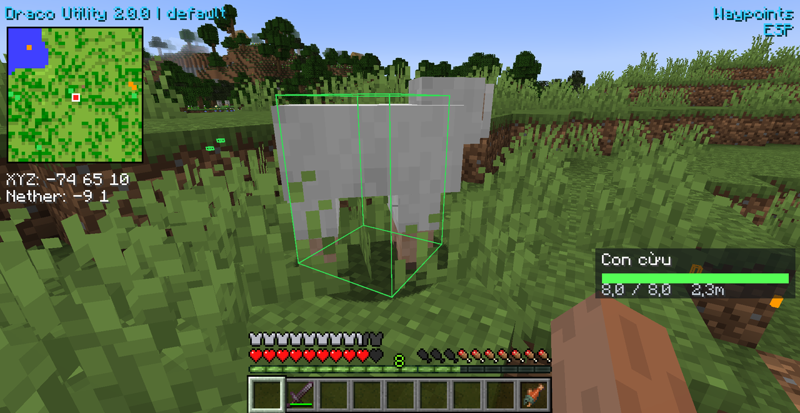
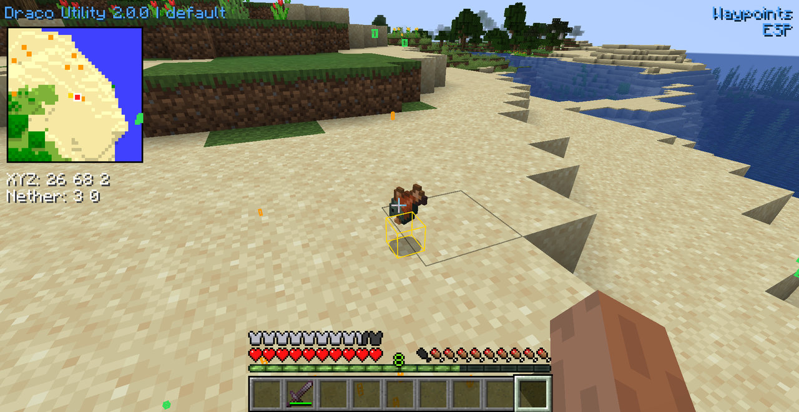
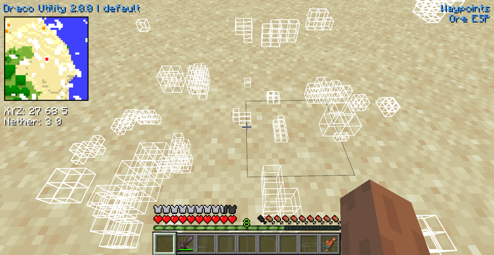
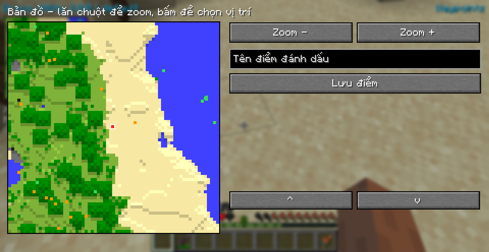

# Draco Utility 2.0.0

**A product of Draco Studio.**
Copyright (C) 2026 DUCNGUYEN-creator (Draco Studio). Licensed under the **GNU General Public License v3**.

A client framework for Minecraft Java Edition (Fabric 1.21.1) for **singleplayer** and **your own private server**:
a module system with a Click GUI, a HUD editor, ESP, X-ray, a guide line, a minimap with waypoints, setting profiles
and chat commands. Version 2.0.0 is a rewrite of 1.1.0 around a small core engine, so every feature is a module that
uses the same settings, events, config, render and scheduling systems.

| | |
|---|---|
| Mod name | Draco Utility (`dracoutility`) |
| Version | 2.0.0 |
| Developer | DUCNGUYEN-creator (Draco Studio) |
| Minecraft | 1.21.1 |
| Loader | Fabric Loader 0.16.0 or newer, plus Fabric API for 1.21.1 |
| Java | JDK 21 |
| Environment | Client only (nothing to install on the server) |
| License | GNU GPL v3 (see `LICENSE`) |

---

## 1. Read this first

**Server policy (replaces the old "permission level 2" gate).** Every module declares what it does (its
*capabilities*: local visual, navigation, world information, movement, combat automation, gameplay automation,
network). A *profile* says which capabilities are allowed where you play:

| Profile | Allowed |
|---|---|
| `private` | everything. Used automatically in **singleplayer**. |
| `info` | UI, local visuals, navigation, world information (ESP, X-Ray, ore finder) |
| `visual` | UI, local visuals, navigation. Used for **every server you did not set up**. |

On your own server run `.policy trust` once while connected; that server then uses `private`. Other commands:
`.policy` (show), `.policy list`, `.policy bind <profile> [server]`, `.policy create <name> [copy]`,
`.policy set <profile> <capability> <on|off>`. A module the profile does not allow stays off (`SUSPENDED`) and the
Click GUI tooltip says why. Draco does not try to detect or hide from anti-cheat; it only refuses to run what you
did not allow, so behaviour on a server is predictable and reproducible.

**Intended use.** Singleplayer or a private server whose rules allow it. Teleport, commands, creative mode and stat
boosts are real server commands (`/tp`, `/gamemode`...) and the server still checks them itself.

### Test status

Automated: **215 checks pass** on the core (`gradlew selfTest`; 151 in 1.1.0 -> 215 in this build). The Minecraft side
compiles against the real Minecraft 1.21.1 / Fabric API jars.

In-game check on **17 Nov 2026**: Minecraft 1.21.1 (Fabric), **singleplayer**, policy profile `private`.

| Feature | Result | Observed |
|---|---|---|
| ESP box (mob) | Pass | All 12 edges visible and even; the box wraps the whole body (sheep: HP 8.0/8.0, 2.3 m shown by the target HUD) |
| Ore ESP | Pass | 12 edges on every box, shown through the sand; boxes stay complete where they touch each other |
| X-Ray | Pass, but dense | Hides soil/stone/sand; red borders on hidden solid blocks. Border limit is `MAX_BOXES = 2500` per frame, so standing close fills the screen |
| Guide | Pass | Line and box to the nearest coal ore, "Guide: Quang than - 9m" in the HUD |
| Click GUI | Pass | Combat / Movement / Render / Player / World / Misc columns, search bar, HUD / Tools / Map / Profile buttons, Tracers and Speed listed, policy line shown |
| Minimap and map screen | Pass | Terrain colors, ore dots, waypoint dialog, zoom |
| HUD | Pass | Title line, coordinates, active module list, target HUD |
| Tracers | **Bug found and fixed** | The first build drew a huge wedge from the crosshair (one world width for the whole line). Width is now computed per end. **Re-test pending** |

Not tested yet: `.policy trust` on a real server (DracoMC), Flight / Speed / Auto PvP on a server profile, Tab completion
for `.` commands, the unclosed-quote error message, addons, Sodium and Iris (`.compat` shows what is loaded).

### New in this 2.0.0 build

- Capability + server policy, `.policy`, `.compat`; module block reasons in the Click GUI.
- Renderer: all 12 box edges drawn as camera-facing ribbons, explicit depth/blend/cull state, state restored.
- Packed-long block scans and a cached ESP list (no per-frame searching, much less garbage).
- X-Ray uses a precomputed table (thread-safe for Sodium workers).
- Strict JSON (depth limit 32) and a command parser that reports unclosed quotes; Tab completion for `.` commands.
- Modules always release shared resources, even if `onDeactivate` throws.
- New: Tracers, Speed; Auto PvP follows normal reach, cooldown and visibility rules (each is a setting).
- Addon API: entrypoint `draco-addon` implementing `studio.draco.utility.addon.DracoAddon`.

---

## 2. Install (Windows)

1. Install **JDK 21** (Temurin is recommended) and **Fabric Loader for 1.21.1** (TLauncher has a ready-made
   "Fabric 1.21.1" version).
2. Download **Fabric API** for 1.21.1 from Modrinth (choose Minecraft 1.21.1 and Fabric) and put the `.jar` in your
   `mods` folder.
3. Close Minecraft.
4. Extract this project, open the extracted folder and double-click **`install.bat`**. It builds the mod, deletes older
   `dracoutility-*.jar` files in `D:\.minecraft\mods` and copies the new jar there. If your game folder is different,
   open `install.bat` in Notepad and change the path.
5. Start the game with **Fabric 1.21.1**.

```
mods/
  dracoutility-2.0.0.jar
  fabric-api-<version>+1.21.1.jar
```

Only `.jar` files belong in `mods`; never keep two versions of `dracoutility` there at the same time.

### Updating from 1.x

On the first start the mod finds `config/dracoutility.properties`, `dracoutility_waypoints.txt` and
`dracoutility_history.txt` from 1.x and converts them into the new format (module states and settings, waypoints and
command history). The old files are left untouched.

---

## 3. Build manually

The project ships with the Gradle wrapper (Gradle 8.10, Fabric Loom 1.7).

```
cd <project folder>
.\gradlew.bat build        (Windows PowerShell)
./gradlew build            (macOS / Linux)
```

The first build takes a few minutes (Minecraft, mappings and libraries are downloaded). `BUILD SUCCESSFUL` means it
worked.

**Where the .jar is after building:**

```
<project folder>\build\libs\dracoutility-2.0.0.jar
```

Use **`dracoutility-2.0.0.jar`** (the mod). Do **not** use `dracoutility-2.0.0-sources.jar`.

Versions live in `gradle.properties` (Minecraft 1.21.1, Yarn `1.21.1+build.3`, Loader 0.16.5, Fabric API
`0.102.0+1.21.1`). If Gradle cannot find one, take the current numbers for 1.21.1 from `fabricmc.net/develop`.

**Low disk space on C:?** Gradle caches libraries in `C:\Users\<name>\.gradle`. Set the `GRADLE_USER_HOME`
environment variable (for example `setx GRADLE_USER_HOME "D:\Downloads\gradle-home"`) and open a new PowerShell.

---

## 4. Using it

### Keys

| Default key | Action | Rebind in |
|---|---|---|
| **Right Shift** | Open / close the Click GUI | Options > Controls > Draco Utility |
| **M** | Open the large map | same |
| (unbound) | Open the tools screen, open the HUD editor | same |

Module keybinds are set in the Click GUI (open a module, click **Bind**) or with `.bind <module> <key>`. A bind can
toggle the module or hold it. Binds are ignored while a screen is open.

### Click GUI

One panel per category (Combat, Movement, Render, Player, World, Misc), plus **Favorites** and a search **Results** panel.

| Action | Result |
|---|---|
| Left click a module | Toggle it |
| Right click a module | Open / close its settings |
| Middle click a module | Add / remove from Favorites |
| Drag a panel header | Move the panel (position is saved) |
| Right click a panel header | Collapse the panel |
| Mouse wheel over a panel | Scroll it |
| Type anywhere | Search modules, descriptions and setting names |
| Settings: click / drag | Toggle, slider (drag), cycle a choice (right click goes back), type text, pick a color, press a key |
| Right click a number | Reset it to the default |

Top bar buttons: **HUD** (HUD editor), **Tools** (teleport, stats, commands), **Map**, and **Profile** (left click =
next profile, right click = previous).

### HUD editor

Drag elements to move them (hold **Shift** for a coarse 8 px grid), scroll to scale, right click to show or hide,
middle click to reset one element. Elements are anchored to the nearest screen corner, so the layout survives a
change of window size.

### Chat commands

Prefix `.` (changeable in the **Client** settings). Messages starting with the prefix are handled by the mod and
never sent to the server.

| Command | What it does |
|---|---|
| `.help [command]` | List commands or explain one |
| `.toggle <module>` / `.enable` / `.disable` | Turn modules on and off |
| `.modules [category]` | List modules |
| `.set <module> [setting] [value]` | Show or change settings (`.set esp range 64`) |
| `.bind <module> <key\|none>` | Key bindings (letters, digits, f1-f12, space, rshift, mouse4...) |
| `.profile list\|load\|create\|copy\|delete\|rename\|export\|import` | Setting profiles |
| `.waypoint add <name>\|list\|remove <name>\|guide <name>` | Waypoints (alias `.wp`) |
| `.config save\|reload` | Save or reload all settings |
| `.gui` `.hud` `.map` `.tools` | Open screens |
| `.perf` | Timing information |

Command argument completion is implemented in the command framework (`CommandManager.suggest`) but is not yet wired
into the chat box.

---

## 5. Modules

| Module | Category | What it does |
|---|---|---|
| **Auto Click** | Combat | Attacks what you look at, mines, or places blocks; clicks per second 0.5 - 20 |
| **Auto PvP** | Combat | Hits the nearest target in reach; choose players, hostile and passive mobs, range, rotate |
| **Auto Totem** | Combat | Keeps a Totem of Undying in your off hand |
| **Flight** | Movement | Survival flight by velocity (a dedicated server needs `allow-flight=true`) |
| **Sprint** | Movement | Sprints automatically when you walk forward |
| **ESP** | Render | Colored boxes and name + distance labels through walls: players red, hostile orange, passive green, items yellow (colors are settings); optional fill |
| **Ore ESP** | Render | White boxes and labels for ores; filter by ore type, scan radius 8 - 64 |
| **Block ESP** | Render | Highlights any blocks you name (default chests, barrels, shulker boxes) |
| **X-Ray** | Render | Only ores, minerals, building blocks, wood, leaves and functional blocks stay visible; red borders on hidden blocks that would block movement; optional fullbright |
| **Fullbright** | Render | Client-side night vision |
| **Breadcrumbs** | Render | Trail of where you walked |
| **Guide** | World | A line to the nearest ore (with type filter), player, hostile or passive mob, item, or to a named waypoint, in the target's color |
| **Waypoints** | World | Shows saved waypoints in the world with name and distance |
| **Auto Respawn** | Player | Respawns when you die |
| **Anti AFK** | Player | Small actions now and then |
| **Client** | Misc | Always on: theme (Classic / Minimal / Glass), accent color, animations, language, command prefix, notification and performance options |

All settings are shown in the Click GUI automatically; they also work with `.set`.

### X-ray details

A whitelist: **ores** (every `_ore` block and Ancient Debris), **mineral blocks**, **wood and leaves**, **building
blocks** (bricks, concrete, glass, wool, stairs, slabs, walls, fences, doors, polished / chiseled / smooth stone,
cobblestone...) and **functional blocks** (everything with block-entity data such as chests, furnaces, spawners,
signs, beds, plus crafting tables, anvils, rails, pistons, TNT, obsidian, ladders, levers...). Everything else is
see-through. Water and lava are still drawn.

---

## 6. HUD elements

All are positioned in the HUD editor and saved with the profile.

| Element | Content |
|---|---|
| Watermark | Name, version, active profile |
| Minimap* | Corner map, size 48 - 160, zoom 1 - 8 blocks per cell; shows ores, entities, waypoints |
| Coordinates | XYZ and the matching Nether / Overworld coordinates |
| Info* | Nearest player and the guide target |
| Direction, Speed, FPS, Ping | Small text readouts (hidden by default except Coordinates) |
| Armor | Four armor pieces with durability |
| Active Modules | Running modules, right aligned |
| Target HUD* | Name, health bar and distance of what you look at |
| Notifications | Toast messages (module on / off, errors, profile changes) |
| Performance | Tick, render, scheduler times, listener count, slowest modules |

\* locked unless you have permission level 2+.

---

## 7. Profiles and files

Profiles hold the module states and settings, the HUD layout and the GUI layout. Waypoints and command history are
shared by all profiles.

```
<game folder>\config\draco\
  config.json                 active profile, schema version
  waypoints.json              (shared)
  history.json                (shared)
  profiles\<name>\modules.json
  profiles\<name>\hud.json
  profiles\<name>\gui.json
  backups\                    automatic backups (newest five kept per file)
  exports\                    exported profiles
```

How the files are handled:

- **Versioned**: every file carries a schema number; older files are migrated step by step.
- **Atomic writes**: written to a temporary file, then moved into place; the previous file is backed up first.
- **Self-healing**: a corrupt file is restored from the newest good backup, or set aside as `*.corrupt-<time>` and
  replaced by defaults. You get a chat message about it when you join a world.
- **Debounced**: dragging a slider does not write a file per step; the config is saved after two quiet seconds, when
  a screen closes and when the game exits.

---

## 8. Architecture

```
DracoUtilityClient -> Bootstrap (ordered lifecycle phases)
                         |
   +---------------------+---------------------------------------------+
   | Core (no Minecraft code, fully unit-tested)                       |
   |  EventBus  Setting engine  Module + ModuleManager  ConfigManager  |
   |  ProfileManager  WorkScheduler  Lifecycle  CommandManager         |
   |  ServiceRegistry  NotificationManager  Profiler  Json             |
   +---------------------+---------------------------------------------+
                         |
   Services: EntityService  PlayerService  BlockScanner  InfoService  NightVision
   Render API (RenderContext + RenderManager)      HUD framework (HudManager)
   Click GUI / HUD editor / Tools / Map            Modules (the features)
```

Key rules:

- **Modules never talk to each other.** They share data through services (one entity scan per tick no matter how many
  modules need it; block scans are spread over ticks by the scheduler).
- **A module registers event listeners in `onActivate()` with `on(...)`**; they are removed automatically when it is
  deactivated, so nothing outlives the module.
- **Module state machine**: `REGISTERED, DISABLED, ENABLING, ENABLED, DISABLING, SUSPENDED, FAILED`. A failed
  activation rolls back completely. Three errors within five seconds switch a module off without affecting others.
- **Rendering goes through one API**: modules describe boxes, lines, fills and labels; `RenderManager` culls them,
  batches them and restores the GPU state.
- **The GUI is generated from the Setting API**, so a new module needs no GUI code.

### Adding a module

```java
public final class MyModule extends Module {
    private final Setting.Int range = general.integer("range", "Range", "Blocks.", 10, 1, 50);

    public MyModule() {
        super("mymodule", "My Module", "Does something useful.", ModuleCategory.MISC);
        requires(EntityService.class);               // optional: services it needs
    }

    @Override protected void onActivate() {
        on(TickEvent.Post.class, e -> { /* runs every tick while the module is active */ });
    }
}
```

Register it in `Bootstrap.registerModules`. It appears in the GUI, `.toggle`, `.set`, search, profiles and the
keybind system with no further work.

### Source layout

```
src/main/java/studio/draco/utility/
  DracoUtilityClient, Draco          entrypoint, owner of all systems
  bootstrap/                         Bootstrap (lifecycle steps, events, per-tick wiring)
  core/                              Minecraft-free engine (event, setting, module, config, scheduler,
                                     lifecycle, command, notification, profiler, service)
  event/                             tick, render and world events
  services/                          entity / player / block scan / info services, targets, X-ray filter
  render/                            RenderContext, RenderManager
  modules/<category>/                the features
  hud/ and hud/elements/             HUD framework and elements
  gui/                               ClickGui, Theme, HudEditorScreen, ToolsScreen, MapScreen
  world/minimap, world/waypoint      map sampling, waypoint data
  input/, commands/, platform/       keybinds, chat commands, permission gate and helpers
  mixin/                             X-ray chunk culling (vanilla and Sodium)
src/test/java/                       CoreSelfTest (plain Java, no JUnit needed)
```

### Running the self-test

```
.\gradlew.bat selfTest
```

It checks the event bus (priority, cancellation, duplicate protection, error isolation, thread guard), settings,
the module state machine (gate, rollback, conflicts, error auto-disable), JSON, config files (atomic write,
debounce, backup recovery, corruption, migration), profiles, the scheduler (budget and starvation), lifecycle,
notifications, the 1.x importer and the command framework. `build` does not run it, so a failing test never blocks
installing the mod.

---

## 9. Not in 2.0.0 (and what to weigh before adding it)

These come from the 2.0 design plan and were left out on purpose; each needs care.

| Item | Why it is not here / what to consider |
|---|---|
| Addon loader and public addon API | The module / event / setting APIs are structured for it, but a stable, versioned public API with isolation is its own project. Do it after 2.0 has settled. |
| More modules (Aim Assist, Trigger Bot, Criticals, Auto Eat, Auto Tool, Inventory manager, Freecam, Trajectories, Chunk visualizer, Portal finder...) | Combat helpers beyond clicking are easy to turn into server-side cheating; Freecam and packet-based modules need deeper hooks. Add them one at a time, each tested. |
| Discord Rich Presence, auto reconnect, custom fonts | Need extra dependencies or hooks into other screens. |
| Click GUI: theme editor, command palette, keyboard navigation, responsive scaling | The GUI has themes, search, favorites, layout persistence and hover animation; the rest is a larger UI project. |
| Tab completion in the chat box | The completion logic exists; showing it needs a chat-screen mixin. |
| Hiding water and lava for X-ray | Needs another hook into the fluid renderer; a wrong method name could break start-up. |
| Pathfinding guide | The guide line is straight. Routing around obstacles needs a path search over loaded blocks. |
| Sodium and Iris verification | Sodium mixins are written but untested; no Iris testing yet. |
| Other Minecraft versions | Rendering and mappings change between versions; a Stonecutter setup would help but much code is version specific. |
| CI and a JUnit suite | `selfTest` covers the core; a GitHub Actions workflow and tests that start the game client are future work. |
| Per-world profiles, GUI localization of module names | Module names and descriptions are English; the tools, HUD and GUI chrome follow the game language (English / Vietnamese). |

---

## 10. Troubleshooting

| Symptom | What to do |
|---|---|
| Build cannot find a Fabric API / Yarn / Loader version | Update the numbers in `gradle.properties` from `fabricmc.net/develop` |
| Build shows red errors in a `.java` file | Copy the whole error text; 2.0.0's Minecraft-side code has not been compiled yet |
| Build runs out of disk space | Move `GRADLE_USER_HOME` to another drive (section 3) |
| Game crashes at start | Check `mods` has Fabric API for 1.21.1 and only one `dracoutility`; send `logs\latest.log` |
| Right Shift does nothing | Another screen is open or the key conflicts; rebind it in Controls, or use `.gui` |
| Modules do nothing | You need permission level 2+ (Allow Cheats / `/op`); a module waiting for it shows an orange name in the GUI |
| Flight pulls you down or kicks you on a server | Set `allow-flight=true` in `server.properties` |
| X-ray has no effect | Make sure it is on and permitted; with Sodium that support is untested |
| Config problems after an update | See chat messages on join; backups are in `config\draco\backups` |

Game log: `<game folder>\logs\latest.log`. The startup report (timing of every lifecycle step) is written to it.

---

## 11. Changelog

- **2.0.0:** rewritten around a core engine: module state machine, event bus, setting engine, versioned config with
  profiles, backups and migration, work scheduler, service registry, render API, Click GUI, HUD framework and editor,
  notifications, command framework, profiler. Features of 1.1.0 migrated to modules; added Sprint, Auto Totem, Auto
  Respawn, Anti AFK, Breadcrumbs, Block ESP, Fullbright and per-module keybinds. Imports 1.x settings.
- **1.1.0:** colored ESP with labels, guide line, auto click with speed and place mode, saved settings, fullbright
  with X-ray, minimap, large map and waypoints, Sodium support (experimental), mod icon.
- **1.0.0:** basic menu, flight, ESP, X-ray, teleport, commands with history, stat boosts, creative toggle,
  auto click, auto PvP.

---

## 12. Screenshots (Draco Utility 2.0.0, tested in game)

Taken on 17 Nov 2026 in singleplayer, Minecraft 1.21.1.

**Render modules**

| ESP: a sheep with its target HUD (12 edges) | ESP with the minimap and HUD lines |
|---|---|
|  |  |

| Ore ESP: boxes through the sand | X-Ray: red borders on hidden blocks |
|---|---|
|  |  |

**Navigation and interface**

| Guide: line to the nearest coal ore | Click GUI |
|---|---|
|  |  |

| Map screen with waypoint dialog | |
|---|---|
|  | |

(The Tools screen, HUD and map follow the game language; the screenshots were taken with the game in Vietnamese.
The Click GUI module names are in English.)

---

## 13. License, credits and disclaimer

**Draco Utility is a product of Draco Studio.**

```
Draco Utility - client framework for Minecraft (Fabric)
Copyright (C) 2026 DUCNGUYEN-creator (Draco Studio)

This program is free software: you can redistribute it and/or modify
it under the terms of the GNU General Public License as published by
the Free Software Foundation, version 3 of the License.

This program is distributed in the hope that it will be useful,
but WITHOUT ANY WARRANTY; without even the implied warranty of
MERCHANTABILITY or FITNESS FOR A PARTICULAR PURPOSE.  See the
GNU General Public License for more details.

You should have received a copy of the GNU General Public License
along with this program.  If not, see <https://www.gnu.org/licenses/>.
```

Minecraft is a trademark of Mojang Studios / Microsoft. This project is not affiliated with Mojang, Microsoft,
Fabric, Sodium or any other client. Fabric, Fabric API and the Yarn mappings belong to the FabricMC team. The Gradle
wrapper files (`gradlew`, `gradlew.bat`, `gradle/wrapper/`) come from the FabricMC example mod template and keep their
own licenses. The mod is provided "as is", without warranty; users are responsible for how they use it, especially on
servers that have rules against it.
